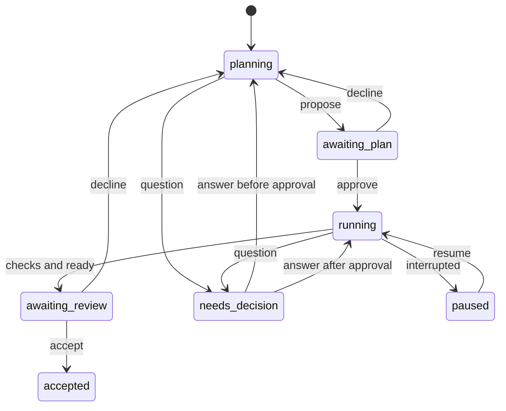

# Ticket UI design

Read the selected ticket's identity and progress, then its workflow, then its
problem, tasks and validation evidence. The active ticket's approval banner stays
at the top because its actions affect the active ticket. Older selections are
explicitly read-only. Existing keys retain their behavior.



Wide layout (current node uses its status color and a bold background):

```text
Ticket u1 · Redesign ticket UI
Status: running · Attempt 1 · Tasks 1/4

╭────────────╮   ╭────────────╮   ╭────────────╮   ╭────────────╮   ╭────────────╮
│ Planning   │ → │ Approve    │ → │ Working    │ → │ Review     │ → │ Accepted   │
╰────────────╯   ╰────────────╯   ╰────────────╯   ╰────────────╯   ╰────────────╯
       ▲                decline from approval or review
       ╰───────────────────────────────────────────────╯
Question → Decision → answer → Planning / Working
Working → Paused → resume → Working

Problem: ...
Tasks / Required checks / Artifacts ...
```

Narrow layout uses stacked nodes with labeled transitions, without horizontal
scrolling. Review and decision banners wrap at the available width.

```text
Workflow · awaiting_review
╭──────────────────╮
│ Planning         │
╰──────────────────╯
        │ propose
        ▼
╭──────────────────╮
│ Approve plan     │
╰──────────────────╯
        │ approve
        ▼
...
Decline: approval/review → Planning
Question → Decision
Answer → Planning / Working
Working → Paused → resume → Working
```

Only the exact current state is highlighted; earlier nodes are not assumed to
have completed, since revisions and resumes can revisit states. Planning before
a recorded problem is still planning. Decision answers return to planning or
working according to approval of the current attempt. Selection remains visible
when there are more tickets than fit in the row. Extremely small windows use
wrapped text in place of boxes.
